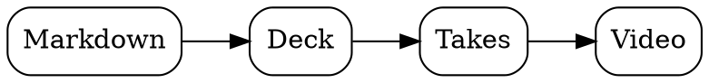

# Slidetake examples

Everything a deck can hold, written in plain markdown. Open **✎ Editor** to see the source of any card, or press **O** for the map.

## ✍️ Text

Paragraphs, **bold**, *italic*, `code`, [links](https://slidetake.com) and lists, as markdown writes them.

- One point
- Another point
  - A detail under it

### Steps

Put `<!-- steps -->` before a list and it reveals one item per press:

<!-- steps -->
- First, the problem
- Then, the idea
- Finally, the result

### Quotes and tables

> A quote stands out from the text around it.

| Plan | Price | Users |
|---|---:|---:|
| Free | ₹0 | 1 |
| Team | ₹499 | 10 |

### Code

```python
def take(slide):
    return slide.best_attempt()
```

## 🧭 Diagrams

Write the diagram in a fenced block named after its language.

### Graphviz



### D2

```d2
direction: right
write: Write {shape: rectangle}
present: Present
record: Record
write -> present -> record: one session
```

### SVG

```svg
<svg xmlns="http://www.w3.org/2000/svg" viewBox="0 0 320 120">
  <rect x="10" y="20" width="90" height="80" rx="10" fill="#22c55e"/>
  <rect x="115" y="20" width="90" height="80" rx="10" fill="#22c55e" opacity=".7"/>
  <rect x="220" y="20" width="90" height="80" rx="10" fill="#22c55e" opacity=".4"/>
</svg>
```

## 📊 Charts

ECharts, as a fenced `echarts` block of JSON options.

### A bar chart

```echarts
{
  "xAxis": {"type": "category", "data": ["Jan", "Feb", "Mar", "Apr", "May"]},
  "yAxis": {"type": "value"},
  "series": [{"type": "bar", "data": [12, 19, 15, 24, 30]}]
}
```

### A donut

```echarts
{
  "series": [{"type": "pie", "radius": ["45%", "70%"],
    "data": [{"name": "Equity", "value": 85}, {"name": "Debt", "value": 5}, {"name": "Gold", "value": 10}]}]
}
```

## 🖼️ Images

The layout comes from what's on the slide; the alt text is the caption.

### One image


### Image and text


An image beside text makes a split card. Write the text first and the image moves to the right.

### A gallery

A list of images is a gallery. With `<!-- steps -->` it becomes a carousel: one image at a time, the next on each press.

<!-- steps -->
- 
- 
- 

### A grid

Several images in one paragraph sit side by side, up to four a row:

  

### Full screen

<!-- view: full -->


## ▶️ YouTube

A YouTube link alone on a line becomes the video. The next press plays it; leaving the slide pauses it.

https://www.youtube.com/watch?v=jNQXAC9IVRw

## 🎥 Camera and map

<!-- camera: on, full, on -->
<!-- view: overview -->

Two comments do what markdown can't: `<!-- camera: on, full, on -->` moves the presenter's camera, and `<!-- view: overview -->` shows the whole map first.

## 🚀 Start your own

Press **New** for a template (blank, talk or recording), or type in this deck to make it your copy.

The templates and this deck live in [examples/](https://github.com/slidetake/slidetake/tree/main/examples) on GitHub.
